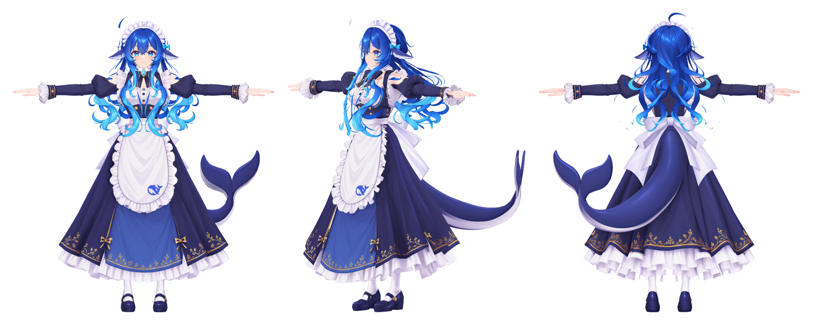

# DeepSeek-chan VRM

  日本語 · <a href="README.en.md">English</a> · <a href="README.zh-CN.md">简体中文</a>

  

Blenderで表示したモデル（陰影なし）。左から正面、斜め前、背面。

DeepSeek-chan の VRM 1.0 モデルです。キャラクターモデリングキット[きゃらくる（Charakuru）](https://github.com/nanocle/Charakuru)を使って作りました。

## ファイル

| ファイル | 内容 |
| --- | --- |
| `DeepSeek-chan.vrm` | 完成した VRM 1.0 モデルです。VRM 対応アプリでそのまま読み込めます。 |
| `DeepSeek-chan.blend` | VRM の書き出し元の Blender ファイルです（Blender 5.2 と VRM Add-on for Blender で作成）。テクスチャはファイル内に格納済みです。 |

## モデルの仕様

- VRM 1.0、マテリアルは MToon
- 表情：プリセット18種（喜怒哀楽、驚き、まばたき、口の形「あいうえお」、視線など）と、それを組み立てる部品の表情23種
- 視線：表情（シェイプキー）で動かす方式
- 揺れもの：40本（髪、スカート、クジラのしっぽ、リボン）、コライダー11個
- ポリゴン数：約9.2万（ほぼすべて三角形）

## 利用条件

VRM に登録した利用条件（[VRM パブリック・ライセンス 1.0](https://vrm.dev/licenses/1.0/)）に従ってください。

| 項目 | 条件 |
| --- | --- |
| 作者 | ニケ |
| アバターとしての利用 | 誰でも可 |
| 商用利用 | 個人の営利目的は可、法人の利用は不可 |
| クレジット表記 | 必要 |
| 改変 | 可 |
| 再配布 | 不可 |
| 過度な性的表現、過度な暴力表現、政治・宗教目的、反社会的・ヘイト目的での利用 | 不可 |

`DeepSeek-chan.blend` も VRM と同じ条件で扱ってください。

## きゃらくるで作ったモデルです

このモデルは、Blender や VRoid Studio で人が形を作る一般的な VRM の作り方とは違う方法で作っています。モデルを改変するときは、次の違いを知っておくと作業しやすくなります。

### 作り方の違い

一般的な VRM は、人が VRoid Studio や Blender で形を作り、ボーンとウェイトを設定し、UniVRM や VRM Add-on for Blender で VRM に変換して作ります。

きゃらくるでは、キャラクターのイラスト1枚から、AI エージェントと分担して作ります。

1. AI エージェントが元のイラストから、頭（髪を含む）と体を4方向ずつ描いた画像と、全身の三面図を作ります。
2. AI エージェントが [Tripo](https://www.tripo3d.ai/) を操作して、その画像から頭と体の3Dモデルの候補を生成します。人は候補の中から使うものを選びます。テクスチャの生成とリギングも Tripo で行います。
3. AI エージェントが Blender を操作して、部位の分離と分類、ウェイト（キット付属の素体から転送）、揺れもの、表情を設定します。
4. 人はローカルアプリで画像・候補・頭身・動きを確認して判断します。Blender を人が直接操作する工程はありません。

公開前の手直し（表情、まばたき、指、スカート、しっぽ、首の付け根の隙間など）も、AI エージェントが Blender のスクリプトで行いました。

### 改変するときに気をつけること

- **メッシュは AI が生成した三角形のメッシュです。** 手作業で作ったモデルのような、四角形のポリゴンとエッジループで整えた形にはなっていません。ループ選択や細分化を前提にした編集はしにくくなっています。
- **顔と後頭部は別のメッシュです。** `Head` は顔の前側だけのメッシュで、後頭部は `Hair`（髪）が覆う構造です。髪を外すと頭の後ろが開いています。
- **テクスチャは部位ごとに生成した4Kの画像です。** 頭、髪、上半身、小物などがそれぞれ別のテクスチャで、1枚の UV に手で配置して描いたテクスチャではありません。
- **揺れものは独立したメッシュです。** 揺れる髪の房やスカート、しっぽ、リボンは `Spring_xx_...` という名前のメッシュに分けてあります。
- **表情はスクリプトで作ったシェイプキーです。** `Head` のシェイプキーを部品の表情（`detail_...`）として登録し、それを組み合わせてプリセットの表情を作っています。
- **制作管理用の名前が残っています。** Blend ファイルには `CharaKit_` で始まるシーンやコレクションがあります。きゃらくるが制作の管理に使っていた名前で、VRM の動作には関係ありません。

### 収録していないもの

- 元のイラストと、制作の途中で生成した画像
- きゃらくるのプロジェクトファイル（`project.charakit`、約1GB）と制作フォルダ（約29GB）。サイズが大きいため収録していません。

## 不具合・ご意見

気になったところがあれば、[Issues](https://github.com/tegnike/deepseek-chan-vrm/issues) で教えてください。修正します。

ただ、私は3Dモデルの専門家ではないので、修正は AI を使って行います。ご了承ください。

## 更新履歴

- 2026-10-31：首の付け根の隙間を修正した版を公開
